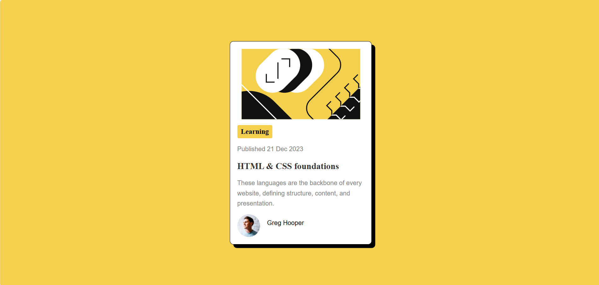

# Frontend Mentor - Blog preview card solution

This is a solution to the [Blog preview card challenge on Frontend Mentor](https://www.frontendmentor.io/challenges/blog-preview-card-ckPaj01IcS). Frontend Mentor challenges help you improve your coding skills by building realistic projects. 

## Overview

### The challenge

-  Build a blog preview card matching the design as closely as possible
- See hover and focus states for all interactive elements on the page

### Screenshot

### Links

- Solution URL: [Add solution URL here](https://your-solution-url.com)
- Live Site URL: https://dappuvarshitha.github.io/Blog-preview-card/

## My process

- First structured the HTML content
- Then styled the card with CSS
- Added flexbox for layout and centering
- Added hover effect on the card title

### Built with

- Semantic HTML5 markup
- CSS custom properties
- Flexbox
- CSS Grid

### What I learned
- How to use `box-sizing: border-box` to manage padding and borders without breaking layouts
- How to use `display: flex` to arrange items side by side
- How to center images using flexbox
- How to use `display: inline-block` for inline elements that need width/height
- How to control spacing between elements using `gap`
- How to use `line-height` for better text readability

### Continued development

- CSS Grid for more complex layouts
- Responsive design and media queries
- CSS animations and transitions